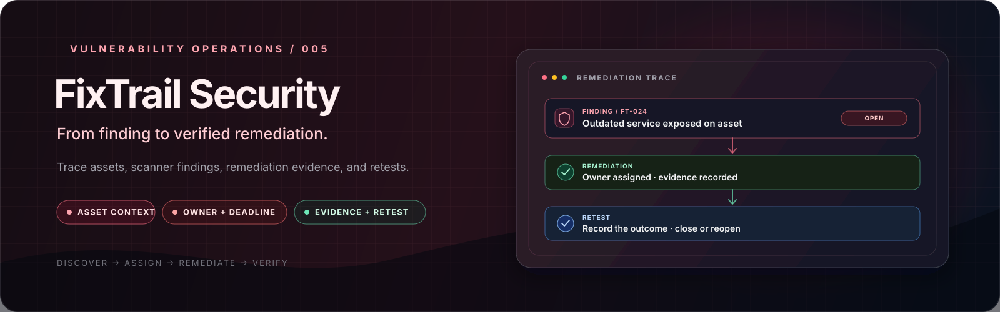

  

<h1 align="center">FixTrail Security</h1>

  <strong>From finding to verified remediation.</strong> 
  A vulnerability-remediation workflow MVP for assets, findings, scanner imports, evidence, and retesting.

  
  
  
  
  
  

  <a href="#overview">Overview</a> ·
  <a href="#current-capabilities">Capabilities</a> ·
  <a href="#architecture-and-workflow">Architecture</a> ·
  <a href="#windows-powershell-quick-start">Quick start</a> ·
  <a href="#security-and-known-limitations">Security review</a> ·
  <a href="#ci-and-verification">CI & tests</a>

---

> [!IMPORTANT]
> **Status: functional local MVP — not production-ready.** The current implementation includes a gated first-admin bootstrap secret, an environment-overridable database connection string, login lockout settings, a login rate-limit policy, JWT bearer authentication, PostgreSQL persistence, JSON/Nmap XML import, and an Angular client. Important gaps remain: bootstrap provisioning is not concurrency-safe or automatically disabled after use; JWT key-strength validation is incomplete; imports can skip invalid rows and expose parser details; workflow transitions are not centrally enforced; remediation/audit read screens and endpoints are incomplete; and PostgreSQL integration tests are not configured in CI. Do not expose this application to an untrusted network or use it to manage sensitive production findings.

## Overview

FixTrail Security is a workflow-oriented vulnerability-remediation application. It is designed to connect a security observation to an affected asset, record repeat observations, assign remediation ownership, store evidence references, and capture retest outcomes.

This repository is **not** a network scanner, exploit framework, CVE-enrichment service, or automatic vulnerability-verification engine. Findings can be entered manually or imported from supported report formats. The Nmap XML parser turns open-port/service observations into informational findings; an open port alone does not prove that a vulnerability exists.

## Current capabilities

| Area | Current implementation |
|---|---|
| Backend | C#, ASP.NET Core Web API on .NET 8 |
| Authentication | ASP.NET Core Identity and JWT bearer access tokens |
| Authorization | Server-side role policies on protected API actions |
| Database | PostgreSQL through EF Core and Npgsql |
| Schema management | Committed EF Core migrations |
| Finding intake | Manual creation, JSON finding arrays, and Nmap XML |
| Duplicate handling | Asset/title/source matching plus a database unique index |
| Workflow records | Remediation tasks, evidence references, retest records, and selected audit events |
| Frontend | Angular 21 standalone components and TypeScript |
| Automated checks | .NET build/xUnit tests, Angular/Vitest tests, and Angular production build in GitHub Actions |
| Deployment | No hosted production deployment or deployment infrastructure is included |

### Features that exist today

- Register assets and retrieve asset inventory.
- Create findings and retrieve findings by ID or asset.
- Record a repeat observation against a matching asset/title/source finding.
- Import JSON arrays and Nmap XML files up to the API's 5 MiB file limit.
- Authenticate users and issue JWT access tokens.
- Enforce role policies for asset/finding writes, imports, remediation assignment, evidence submission, and retesting.
- Create remediation tasks, store evidence references, record retest outcomes, and write selected workflow events to PostgreSQL.

**API support is not the same as a complete user workflow.** The current Angular client covers login, asset screens, finding entry/listing, and import. It does not yet provide a complete connected UI for task assignment, evidence submission, retest history, audit timeline, or user/role management. Dedicated read endpoints for task/evidence collections and audit timelines are also absent.

## Roles and API access

The source defines these roles:

- **Admin**
- **SecurityAnalyst**
- **RemediationOwner**
- **ReadOnly**

| Operation | Admin | SecurityAnalyst | RemediationOwner | ReadOnly |
|---|---:|---:|---:|---:|
| Read assets and findings | Yes | Yes | Yes | Yes |
| Create assets and findings | Yes | Yes | No | No |
| Import JSON/Nmap reports | Yes | Yes | No | No |
| Assign remediation tasks | Yes | Yes | No | No |
| Submit evidence for a matching remediation task | Yes | Yes | Yes | No |
| Record retest outcomes | Yes | Yes | No | No |
| Manage users/roles through a dedicated API | Not implemented | Not implemented | Not implemented | Not implemented |

These are the access rules expressed by the current controller policies; they are not a claim of complete authorization test coverage. Backend authorization remains the security boundary. Frontend guards or hidden buttons must never be relied on to protect an API.

## Authentication and first-administrator provisioning

### Login protections currently present

The current API configures ASP.NET Core Identity lockout after **5 failed attempts**, with a **15-minute** lockout period for eligible accounts. The login action checks lockout state, records failed attempts, resets the failed count after successful authentication, and applies the configured fixed-window <code>LoginPolicy</code> rate limiter.

The current rate limiter is configured for five requests per one-minute window. It is a simple fixed-window policy, not a complete per-user/per-IP abuse-prevention strategy. It should be reviewed before public deployment.

### JWT and browser storage

The API validates token signature, issuer, audience, and expiry. The signing secret must be supplied through configuration and must be strong, randomly generated material. **The current source only checks that the JWT secret is non-empty; it does not enforce a minimum signing-key length or fully validate all token settings at startup.** No refresh-token flow is implemented.

The Angular auth service currently stores the access token in <code>sessionStorage</code>, rather than <code>localStorage</code>. This avoids ordinary persistence across browser sessions, but same-origin JavaScript can still read the token. It is not equivalent to a properly designed <code>HttpOnly</code>, <code>Secure</code>, <code>SameSite</code> cookie session and does not remove the need for XSS prevention.

### Bootstrap gate and its remaining limitation

The initial-admin endpoint is <code>POST /api/auth/bootstrap</code>. It is available only when <code>BootstrapSettings:Secret</code> is configured and the request supplies the expected value in the <code>X-Bootstrap-Secret</code> header. The current controller uses a fixed-time byte comparison for that secret and refuses provisioning when it detects an existing administrator.

This is a meaningful improvement over an unrestricted bootstrap endpoint, but it is **not a fully one-time or concurrency-safe provisioning mechanism**. The configured secret remains usable while it exists, and the current check/create sequence is not atomic. For local setup, keep the API bound to a trusted local environment, use a high-entropy temporary secret, create the initial administrator, and remove the secret immediately afterward. Do not expose this endpoint to the public internet.

There is no dedicated administrator user/role management API.

## Architecture and workflow

~~~mermaid
flowchart LR
    UI[Angular Client] --> AUTH[Login / JWT]
    AUTH --> API[ASP.NET Core API]
    API --> POL[Authentication + RBAC Policies]
    POL --> ASSETS[Assets and Findings]
    POL --> IMPORT[JSON / Nmap XML Import]
    POL --> REM[Remediation Actions]
    ASSETS --> DB[(PostgreSQL / EF Core)]
    IMPORT --> DB
    REM --> DB
    REM --> AUDIT[Selected Audit Events and Retest Records]
    AUDIT --> DB
~~~

### Intended finding lifecycle

~~~mermaid
stateDiagram-v2
    [*] --> Open
    Open --> Assigned: Assign task
    Assigned --> Mitigated: Submit evidence
    Mitigated --> Closed: Successful retest
    Mitigated --> Reopened: Failed retest
~~~

This diagram depicts the intended common path, **not a fully enforced state machine**. The current domain method permits status replacement without a centralized transition policy, and the endpoints do not yet reject every invalid transition. Treat the lifecycle as an MVP workflow, not as an enforced release-control mechanism.

### Main domain records

| Entity | Purpose |
|---|---|
| <code>Asset</code> | System/service identity, environment, owner, and creation time |
| <code>Finding</code> | An observation associated with an asset, including source-provided severity |
| <code>FindingOccurrence</code> | Records a repeated observation of a finding |
| <code>RemediationTask</code> | Assignee, due date, notes, and associated finding |
| <code>EvidenceReference</code> | A URL/path and description associated with a remediation task |
| <code>RetestRecord</code> | Retest outcome, operator identity, notes, and timestamp |
| <code>AuditEvent</code> | A database record of selected remediation events |
| <code>ApplicationUser</code> | ASP.NET Core Identity user with a full-name field |

Audit events are ordinary application/database records. They are not cryptographically tamper-proof, and privileged database access can alter or remove them. Several child records use cascade-delete relationships, so deletion semantics and history retention need further hardening.

## API reference

The following routes are present in the current controllers. Domain routes require authentication; write actions also apply their specific role policies.

| Method | Route | Access / purpose |
|---|---|---|
| <code>POST</code> | <code>/api/auth/bootstrap</code> | Bootstrap an initial administrator when the configured bootstrap secret is accepted |
| <code>POST</code> | <code>/api/auth/login</code> | Authenticate and return a JWT access token |
| <code>GET</code> | <code>/api/assets</code> | Authenticated: list assets |
| <code>POST</code> | <code>/api/assets</code> | Admin or SecurityAnalyst: create an asset |
| <code>GET</code> | <code>/api/assets/{id}</code> | Authenticated: retrieve an asset |
| <code>POST</code> | <code>/api/findings</code> | Admin or SecurityAnalyst: create a finding or record an occurrence |
| <code>GET</code> | <code>/api/findings/{id}</code> | Authenticated: retrieve a finding |
| <code>GET</code> | <code>/api/findings/asset/{assetId}</code> | Authenticated: list findings associated with an asset |
| <code>POST</code> | <code>/api/importer/upload/{assetId}</code> | Admin or SecurityAnalyst: upload a supported JSON or Nmap XML file |
| <code>POST</code> | <code>/api/findings/{findingId}/remediation/assign</code> | Admin or SecurityAnalyst: assign remediation |
| <code>POST</code> | <code>/api/findings/{findingId}/remediation/tasks/{taskId}/evidence</code> | Admin, SecurityAnalyst, or RemediationOwner: submit task evidence |
| <code>POST</code> | <code>/api/findings/{findingId}/remediation/retest</code> | Admin or SecurityAnalyst: record a retest outcome |

The API does not yet expose dedicated endpoints for listing remediation tasks, retrieving an evidence collection, or reading an audit timeline. The corresponding full Angular workflows are not implemented either. Finding-by-asset results are currently returned without a pagination contract.

## Import formats and data integrity

### JSON finding array

The importer accepts a JSON array of finding DTOs. Example:

~~~json
[
  {
    "title": "Example security observation",
    "description": "A sample observation from an approved assessment.",
    "source": "ExampleScanner",
    "sourceSeverity": "High",
    "externalId": "EXAMPLE-001"
  }
]
~~~

This is illustrative sample data, not a real vulnerability report.

The importer checks the uploaded file, a 5 MiB size limit, file extension, and asset existence, and it wraps database writes in a transaction. However, its current implementation can **skip rows with missing title/severity instead of rejecting the entire batch**, despite returning a success message that says an all-or-nothing policy was enforced. Its parser-error response also includes exception details. These behaviors need correction before the importer can be treated as a strict all-or-nothing intake boundary.

### Nmap XML

The parser extracts open-port and available service/product/version metadata from an Nmap XML report and creates informational observations. It does not run Nmap, prove that a service is vulnerable, match CVEs, calculate CVSS, or determine exploitability.

The current parser calls <code>XDocument.Load</code> without explicitly configuring a restricted <code>XmlReader</code>. Safe, bounded XML parsing and hostile-input regression tests remain outstanding. Import only reports from systems you own or are explicitly authorized to assess.

### Duplicate identity and database history

The current database has a unique index on <code>(AssetId, Title, Source)</code>. This helps reject concurrent duplicate rows for that key, but it can merge observations that happen to share those fields, and the index migration must be evaluated against databases that already contain duplicates. Do not delete findings or associated history casually to make a migration succeed.

The application records selected occurrence, remediation, and retest data, but workflow-state invariants, history-retention semantics, and end-to-end PostgreSQL testing remain incomplete.

## Windows PowerShell quick start

### Prerequisites

- .NET SDK 8.x
- Node.js 24.x and npm (matching the current CI workflow)
- PostgreSQL
- Git
- EF Core CLI tool (<code>dotnet-ef</code>) 8.x

### 1. Clone the repository

Run in Windows PowerShell:

~~~powershell
git clone https://github.com/tracolerd/fixtrail-security.git
Set-Location .\fixtrail-security
~~~

### 2. Create a local database

If PostgreSQL command-line tools are on your <code>PATH</code>, create a local development database with:

~~~powershell
psql -U postgres -c "CREATE DATABASE fixtrail;"
~~~

If the database already exists, do not recreate or drop it.

### 3. Configure local secrets

The tracked <code>FixTrailSecurity.Api/appsettings.Development.json</code> contains a <code>YOUR_DB_PASSWORD_HERE</code> placeholder, **not a working/default database password**. <code>Program.cs</code> refuses to start if that placeholder is still the effective connection string. Use .NET User Secrets for your own local credentials and signing material.

From the repository root, replace each placeholder before running the commands:

~~~powershell
dotnet user-secrets set "ConnectionStrings:DefaultConnection" "Host=localhost;Port=5432;Database=fixtrail;Username=postgres;Password=REPLACE_WITH_YOUR_LOCAL_PASSWORD" --project .\FixTrailSecurity.Api
dotnet user-secrets set "JwtSettings:Secret" "REPLACE_WITH_A_LONG_RANDOM_SECRET_OF_AT_LEAST_32_BYTES" --project .\FixTrailSecurity.Api
~~~

The application currently requires the JWT secret to be present, but the code does not validate that it meets the recommended minimum strength. Supply a long, randomly generated secret and never commit it.

For first-time provisioning on a fresh local database only, set a separate high-entropy temporary bootstrap secret:

~~~powershell
dotnet user-secrets set "BootstrapSettings:Secret" "REPLACE_WITH_A_SEPARATE_RANDOM_BOOTSTRAP_SECRET" --project .\FixTrailSecurity.Api
~~~

Do not use the JWT secret as the bootstrap secret. Do not paste either secret into a public issue, screenshot, README, or commit.

### 4. Restore, build, and test the backend

From the repository root:

~~~powershell
dotnet restore
dotnet build --no-restore
dotnet test .\FixTrailSecurity.Tests\FixTrailSecurity.Tests.csproj --no-build --verbosity normal
~~~

The audited test suite has 12 xUnit tests. They are not a substitute for PostgreSQL-backed integration tests or end-to-end authorization/workflow tests; those are not currently configured in CI.

### 5. Apply database migrations

Install the EF Core CLI only if you do not already have a compatible 8.x version:

~~~powershell
dotnet tool list --global
dotnet tool install --global dotnet-ef --version 8.0.10
~~~

If <code>dotnet-ef</code> is already installed, do not install it a second time. Apply migrations only to your intended local development database:

~~~powershell
dotnet ef database update --project .\FixTrailSecurity.Api --startup-project .\FixTrailSecurity.Api
~~~

Never run this command against production or an unknown database without a reviewed migration plan and a backup.

### 6. Start the API

From the repository root:

~~~powershell
$env:ASPNETCORE_ENVIRONMENT = "Development"
dotnet run --project .\FixTrailSecurity.Api --urls "http://localhost:5000"
~~~

The API's Development environment enables Swagger UI at <code>/swagger</code> on the active API URL. The application also has HTTPS-redirection middleware, so follow the URL/redirect behavior printed by your local ASP.NET Core process if it differs from the address above.

### 7. Bootstrap the initial administrator

Only perform this step if the local database does not already have an administrator. Keep the API restricted to the local trusted environment.

Use the same temporary bootstrap secret that you placed in User Secrets. Replace the password placeholder before running:

~~~powershell
$bootstrapSecret = "REPLACE_WITH_THE_SAME_TEMPORARY_BOOTSTRAP_SECRET"
$bootstrapBody = @{
    email    = "admin@example.local"
    password = "REPLACE_WITH_A_STRONG_UNIQUE_PASSWORD"
    fullName = "Local Administrator"
} | ConvertTo-Json

Invoke-RestMethod -Method Post -Uri "http://localhost:5000/api/auth/bootstrap" -Headers @{ "X-Bootstrap-Secret" = $bootstrapSecret } -ContentType "application/json" -Body $bootstrapBody
~~~

After provisioning succeeds, remove the bootstrap secret immediately so subsequent bootstrap requests are disabled by configuration:

~~~powershell
dotnet user-secrets remove "BootstrapSettings:Secret" --project .\FixTrailSecurity.Api
~~~

If provisioning failed or an administrator already exists, investigate the returned result instead of repeatedly attempting bootstrap.

### 8. Start the Angular client

Open a second PowerShell terminal from the repository root:

~~~powershell
Set-Location .\FixTrailSecurity.Client
npm ci
npm start
~~~

Open the local Angular URL printed in the terminal (normally <code>http://localhost:4200</code>). Keep PostgreSQL and the API running.

The Angular auth service currently hard-codes the API base URL to <code>http://localhost:5000/api/auth</code>, and the backend CORS policy currently allows <code>http://localhost:4200</code>. These local values need environment-specific configuration before using the app in another environment.

## CI and verification

GitHub Actions is configured in <code>.github/workflows/ci.yml</code> to perform:

1. .NET dependency restore.
2. .NET backend build.
3. xUnit tests.
4. Angular dependencies installed with <code>npm ci</code>.
5. Angular unit tests using the project's configured Vitest-based Angular test builder.
6. Angular production build.

### Verified implementation snapshot

The implementation commit <code>9b872bd44742845fce66f6ac880ba234b1a2d384</code> passed [GitHub Actions run #15](https://github.com/tracolerd/fixtrail-security/actions/runs/39655862358). In that run, .NET build succeeded with zero warnings and zero errors, all 12 xUnit tests passed, the Angular unit-test step passed, and the Angular production build succeeded.

This run verifies the configured checks for that specific commit. Documentation commits also trigger CI; use the live [Actions page](https://github.com/tracolerd/fixtrail-security/actions) and badge above for the status of the current <code>main</code> HEAD.

**A green pipeline is not a clean security audit.** The dependency-install output in run #15 reported four npm audit findings (one low and three high) and a Node <code>punycode</code> deprecation warning. The workflow currently installs dependencies but does not include a dedicated <code>npm audit</code> triage step. Re-run and review the current dependency audit before treating dependencies as clean.

The CI workflow currently has no PostgreSQL service and does not run PostgreSQL-backed integration tests. A successful build and unit-test suite does not prove migrations, database transactions, authorization, or the complete remediation workflow end to end.

## Security and known limitations

The following limitations are based on the current repository source. They are not the result of a live penetration test or an independent security certification.

### Authentication and configuration

- The database password in tracked Development settings is a placeholder and startup rejects it if it remains the effective connection string. Real credentials belong in User Secrets locally and an appropriate secret manager in deployment.
- The JWT signing secret is required but the code does not enforce a minimum key length or comprehensively validate all JWT settings at startup.
- Bootstrap is secret-gated, but the provisioning sequence is not atomic or concurrency-safe, and the gate remains active until the configured secret is removed. A secure CLI provisioning flow or stronger one-time mechanism would be preferable.
- Login has Identity failed-attempt lockout and a fixed-window rate limit; the current limiter is not a comprehensive per-client abuse-control system.
- Access tokens are stored in <code>sessionStorage</code>; there is no refresh-token flow or cookie-based session design.
- The UI still contains an inline logout handler, and the API URL/CORS origin are local hard-coded values.

### Import and workflow

- JSON row validation is incomplete. Some invalid rows are skipped despite a success message that claims all-or-nothing behavior.
- Import parser errors include raw exception details in the response.
- XML parsing lacks explicit restricted-reader configuration and dedicated hostile-input tests.
- Finding duplicate identity is based on asset ID, title, and source; evaluate this key for false merging and existing-data migration behavior.
- Finding status updates do not enforce a central legal-transition state machine.
- Remediation task/evidence list endpoints and audit timeline reads are not implemented; the corresponding complete UI flows are missing.
- User/role management endpoints are not implemented.
- Finding/asset list contracts do not yet provide a full pagination/filtering strategy.
- Audit events are database records, not cryptographically tamper-evident logs. Cascade-delete relationships can remove associated records.

### Test coverage and dependency risk

- The xUnit suite currently contains 12 tests, and the Angular suite is still small.
- PostgreSQL-backed API integration tests are not configured in CI.
- The latest audited dependency-install output reported four npm audit findings (one low, three high); review current advisories and remediation options rather than applying force upgrades blindly.
- No production deployment, backup/recovery verification, observability configuration, or independent penetration test is included in this repository.

Use this project as a local portfolio MVP until these limitations are addressed and tested.

## Repository layout

~~~text
.
├── assets/
│   └── fixtrail-security-banner.svg
├── FixTrailSecurity.Api/
│   ├── Controllers/       # Auth, assets, findings, importer, remediation
│   ├── DTOs/              # Request and response models
│   └── Migrations/        # EF Core migrations and model snapshot
├── FixTrailSecurity.Client/
│   └── src/app/
│       ├── components/    # Login, assets, findings
│       ├── guards/        # Auth route guard
│       ├── interceptors/  # JWT authorization header
│       ├── models/
│       └── services/
├── FixTrailSecurity.Core/
│   ├── Constants/         # Role names
│   ├── Data/              # EF Core Identity DbContext
│   ├── Entities/          # Assets, findings, remediation, audit, users
│   └── Services/          # Nmap XML parser
├── FixTrailSecurity.Tests/ # xUnit tests
├── docs/
│   ├── DECISIONS.md
│   ├── DEPLOYMENT.md
│   └── PROJECT_STATE.md
├── .github/workflows/ci.yml
├── FixTrailSecurity.sln
└── LICENSE
~~~

---

## Creator, Developer & Maintainer

**Created, designed, developed, and maintained by [Nurul Faiyaz](https://github.com/tracolerd).**

This project is independently built and maintained by Nurul Faiyaz. The project's design, implementation, and documentation are his work.

  
  
  
  
  
  
  

  <a href="https://www.facebook.com/faiyaz.888">Facebook</a> ·
  <a href="https://www.instagram.com/tracolerd">Instagram</a> ·
  <a href="https://www.linkedin.com/in/faiyaz-xyz">LinkedIn</a> ·
  <a href="https://x.com/faiyaz_explores">X / Twitter</a> ·
  <a href="https://github.com/tracolerd">GitHub</a> ·
  <a href="mailto:scrollfaiyaz@gmail.com">Email</a> ·
  <a href="https://nurul-faiyaz.netlify.app/">Portfolio</a>

## License

MIT. See [LICENSE](LICENSE).